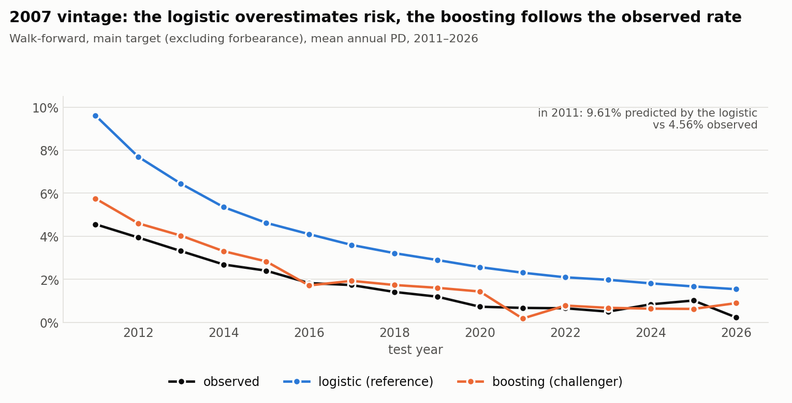
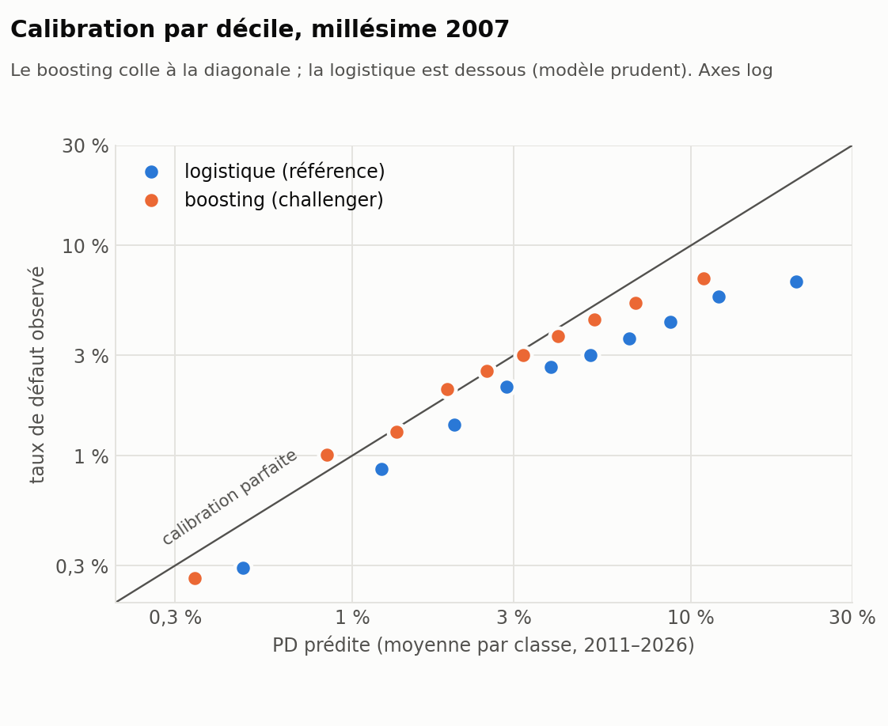
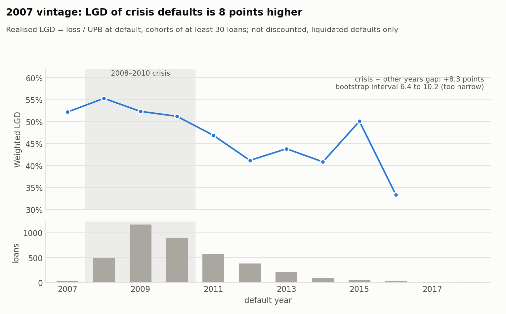

# PD Model Validation on Freddie Mac Mortgage Data: Logistic Regression vs Gradient Boosting

Out-of-sample validation of two probability-of-default (PD) models, a logistic regression (reference) and a gradient boosting (challenger), on Freddie Mac Single-Family Loan-Level data (vintages 2007 and 2015, 50,000 loans each), run as a model reviewer would: expanding-window backtesting, bias tests robust to autocorrelation, paired model comparison, discrimination and calibration, realised LGD in crisis versus normal years, and the behaviour of the tests when defaults become rare.

The code is split in two: a **domain-independent core** (`core/`: residuals and bias by group, Newey–West, Diebold–Mariano, Gini / KS / PSI, calibration tests) and a **credit module** (`credit/`: Freddie Mac reader, default rule, loan-year panel, PD models, LGD).

**Scope.** This is not an independent validation of a bank model. The models under review are the ones I built myself, on public US mortgage data. The project says nothing about the models or portfolios of any bank. It measures how a standard validation toolkit behaves on a reference model and a challenger, and where its tests lose power.

## Data
- Freddie Mac Single-Family Loan-Level Dataset, standard samples of 50,000 loans for vintages 2007 and 2015 (origination and monthly performance files).
- **The data are not in this repository**: the licence forbids redistribution. To reproduce, download the files from the Freddie Mac website and place them as follows:

```
data/raw/file_layout_july_2026.xlsx
data/raw/sample_2007/sample_orig_2007.txt   sample_perf_2007.txt
data/raw/sample_2015/sample_orig_2015.txt   sample_perf_2015.txt
```

- Notebook `01` converts these files to CSV (`data/interim/`). The `data/` folder is excluded by `.gitignore`.

## Method
- **Out-of-sample only.** Expanding-window walk-forward: each test year is predicted by a model trained on all strictly earlier years, never random cross-validation. A test checks that no information leaks from the future. First test year: 2011 for the 2007 vintage (16 test years), 2019 for the 2015 vintage (8 test years).
- **Default rule v2** (`docs/regle_defaut.md`, in French): 90 days or more past due, foreclosed property, or exit through a default-type zero-balance code. Defaults caused by payment suspension (forbearance) or disasters are kept but flagged. The main run is trained on the target excluding forbearance; a sensitivity run includes it.
- **Residual convention**: observed − predicted. A positive residual means the model underestimates risk.
- **Bias**: Newey–West standard errors (Bartlett kernel, default lags `floor(4(n/100)^(2/9))`), with 0 to 4 lags as a sensitivity check, because yearly residuals are autocorrelated.
- **Paired comparison**: Diebold–Mariano on the yearly sample-size-weighted squared calibration error, with the Harvey small-sample correction.
- **Discrimination and stability**: Gini and KS, reported only for years with at least 30 defaults; PSI at origination between vintages (2007 as reference).
- **Calibration**: exact binomial test against the Vasicek one-factor corrected test (asset correlation ρ = 0.05 / 0.15 / 0.24), Clopper–Pearson intervals.
- **Realised LGD**: Actual Loss / Current Actual UPB at the default month, by default-year cohort, for loans liquidated with a loss (`docs/lgd.md`, in French). Not discounted.
- **Regimes**: defined by calendar, identical for both vintages: `crise_2008` (2008–2010), `stress_2020` (2020), `normal` otherwise.
- **Low-default segment**: defined at origination (FICO ≥ 760, CLTV ≤ 70, DTI ≤ 36, 2015 vintage) before any default was counted on it, then used to measure how the tests behave as defaults get scarce.

## Key results
Main run (target excluding forbearance).

| | 2007 vintage | 2015 vintage |
|---|---|---|
| Loans / defaults (forbearance included) | 50,000 / 8,265 (16.5%) | 50,000 / 2,058 (4.1%) |
| Of which defaults in 2020 | — | 1,115 |
| Default rate excluding forbearance | 16.1% | 1.34% |
| Test years | 16 (2011–2026) | 8 (2019–2026) |
| Mean Gini (years with ≥ 30 defaults) | 0.35 (both models) | 0.48 logistic, 0.42 boosting |

- **Forbearance contaminates training.** 2015 vintage, year 2021: mean logistic PD is 4.96% when trained with forbearance defaults and 0.28% without (observed excluding forbearance: 0.09%).
- **Bias, 2007 vintage.** The logistic overestimates risk (−2.1 points on average, p < 0.001, Newey–West). The boosting is much better calibrated (−0.3 point, p = 0.027) and loses less than the logistic (Diebold–Mariano, p = 0.019). 2015 vintage: no significant result, low power.
- **Calibration.** The binomial test rejects the logistic in 15 of 16 years on the 2007 vintage for overestimation, because it assumes independent defaults. With the Vasicek correction (ρ = 0.15), no year is rejected. The conclusion depends on ρ.
- **Realised LGD (2007 vintage, 4,043 loans liquidated with a loss).** Median LGD 53%. Defaults of 2008–2010: 52.5% weighted LGD, against 44.2% for other years (+8.3 points, bootstrap interval [6.4; 10.2], too narrow because it ignores loss correlation).
- **Low-default segment** (2015 vintage): 15 defaults over the test years. To detect a true PD twice the announced one, the exact binomial test has a power of 99.8% with 30 defaults, 84% with 10 and 54% with 5.
- **Population stability.** PSI of the 2015 vintage against 2007 at origination: DTI shows 1.32, an artefact of empty top bins (DTI is capped at 50 in 2015); with fixed bins it is 0.39.

## Figures
Generated by `scripts/generer_figures.py` from aggregated results only (no loan-level row).


2015 vintage. On the left, trained with forbearance defaults, both models strongly overpredict after 2020 (logistic: 4.96% in 2021 against 0.5% observed). On the right, excluding forbearance, they follow the observed rate.



2007 vintage, main run. The logistic overestimates risk over the whole period; the boosting follows the observed rate more closely.



Observed rate against predicted PD for ten risk classes. Below the diagonal, the model is conservative.



Realised LGD by default year, cohorts of at least 30 loans. The interval on the crisis / other-years gap ignores loss correlation and is too narrow.


Probability that an exact binomial test detects a true PD 2 or 3 times higher than the announced one. The sawtooth comes from the discrete nature of the exact test.

## Decision log
Fixed in `config/freddie_mac.yaml` (section `historique_des_decisions`), with the order in which each choice was made relative to the results.

| Decision | Fixed | Note |
|---|---|---|
| Default rule v1, threshold of 30 defaults | before results | |
| Expanding-window walk-forward, test starts 2011 and 2019, 10 risk classes, logistic vs boosting, crisis 2008–2010 | before results | the first test year of the 2015 vintage (2019) was suggested by the assistant |
| Default rule v2 (forbearance flag) | **after** results | motivated by 2020 counts: 94.4% and 87.1% of 2020 defaults carry a relief marker |
| Main run trained excluding forbearance, sensitivity run with it | **after** results | chosen after measuring the 2021 contamination |
| `stress_2020` regime, same regimes for both vintages | **after** results | also fixed an omission of 2020 for the 2007 vintage |
| Low-default segment (FICO ≥ 760, CLTV ≤ 70, DTI ≤ 36) | before results | only loan counts had been looked at |
| LGD definition (a) only | before results | feasibility choice; workout LGD is described and set aside in `docs/lgd.md` |

## Limitations
- **Not an independent validation**: I validate models I built myself.
- **Nothing on the models or portfolios of a bank.** US mortgages, samples of 50,000 loans.
- **Out of scope**: CCF, lifetime PD and IFRS 9 stages, corporate lending, European specifics.
- **Regulatory conservatism margin and downturn calibration are not implemented.** The crisis / normal contrast is descriptive; it is not the adjustment of EBA/GL/2019/03, which I have not read.
- **The 2008–2010 crisis is never observed out of sample** (first test years: 2011 and 2019). The only stress tested is 2020, and excluding forbearance it is no longer a credit crisis.
- **Low statistical power**: 8 to 16 test years, a few dozen defaults per cell in the finest cuts.
- **Default definition**: inspired by the prudential definition (CRR art. 178, quoted from memory, not re-read) without a materiality threshold, since the data give no past-due amount. EBA/GL/2016/07 has not been read either.
- **The asset correlation ρ of the Vasicek test (0.15) is an assumption** to confirm in the regulatory text; results are given for 0.05, 0.15 and 0.24.
- **LGD is a liquidation LGD**: not discounted, ignores defaults that returned to performing status (`docs/lgd.md`).
- **The regime boundaries** (2008–2010) have not yet been checked against aggregate series (FRED).
- **Not done**: reuse on a second dataset (SBA).

## Repository
```
config/freddie_mac.yaml     parameters fixed before results (default rule, threshold, segment, ...)
docs/regle_defaut.md        default rule v1 / v2 and why it changed (in French)
docs/lgd.md                 LGD definition retained and what it does not cover (in French)
src/validation_toolkit/
  core/                     domain-independent: residuals and bias by group, Newey–West,
                            Diebold–Mariano, regimes, Gini / KS / PSI, calibration tests
  credit/                   Freddie Mac reader, data quality, defaults, panel, PD models, LGD
scripts/generer_figures.py  regenerates docs/images/ (aggregated results only)
tests/                      pytest: synthetic files with a known answer, plus tests on real data
exploration/                notebooks 01 to 07 (written in French)
```

| Notebook | Content |
|---|---|
| 01 | Conversion, consistency checks, defaults (rule v1 then v2), available losses, missing FICO |
| 02 | Test of the residual function on synthetic data with a known bias |
| 03 | Loan-year panel, walk-forward PD models, input table of the core |
| 04 | Robust bias (Newey–West), paired comparison (Diebold–Mariano), results by regime |
| 05 | Gini / KS, PSI, calibration (binomial vs Vasicek), sensitivity to the number of lags |
| 06 | Realised LGD by default year, crisis / normal contrast |
| 07 | Low-default segment: from how many defaults the tests become unusable |

## Reproduce
```bash
pip install -r requirements.txt
pytest                              # 172 tests; those on real data are skipped if data/interim is empty
python scripts/generer_figures.py   # regenerates docs/images/
```
Then run the notebooks of `exploration/` in order, after placing the Freddie Mac files in `data/raw/`.

## Source
Freddie Mac, Single-Family Loan-Level Dataset: https://www.freddiemac.com/research/datasets/sf-loanlevel-dataset (free of charge, subject to Freddie Mac's licence terms; redistribution of the data is not allowed).
