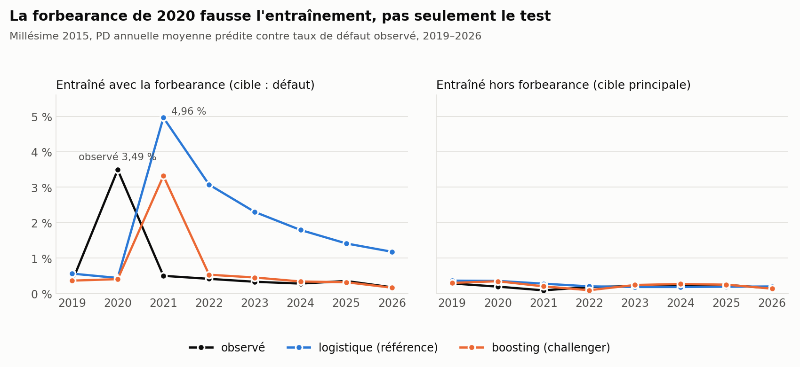
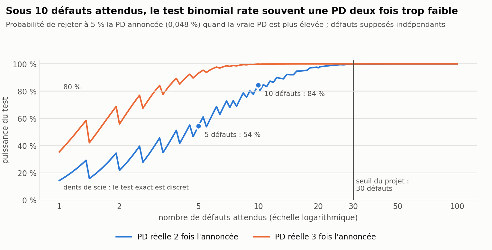

# validation-toolkit — validation d'un modèle de PD sur données Freddie Mac

Projet personnel (Côme, M2 M2MO, Université Paris Cité). Une boîte à outils Python de validation de modèles, avec un **cœur indépendant du domaine** (`core/`) et un **module crédit** (`credit/`) appliqué à des prêts immobiliers américains.

Ce que le projet fait : construire un modèle de PD de référence (régression logistique) et un challenger (gradient boosting), puis les soumettre à une batterie de validation hors échantillon : biais, discrimination, calibration, stabilité, comparaison appariée, LGD réalisée et contraste crise / période normale, comportement des tests quand les défauts deviennent rares.

**Ce que le projet n'est pas** : la validation indépendante d'un modèle bancaire. Les modèles validés sont ceux que j'ai construits, sur des données publiques américaines. Voir « Limites » plus bas.

## Données

Single-Family Loan-Level Dataset de Freddie Mac, échantillons standard de 50 000 prêts pour les millésimes 2007 et 2015. **Les données ne sont pas dans ce dépôt** : la licence interdit leur redistribution. Pour reproduire, les télécharger sur le site de Freddie Mac et les placer ainsi :

    data/raw/file_layout_july_2026.xlsx
    data/raw/sample_2007/sample_orig_2007.txt   sample_perf_2007.txt
    data/raw/sample_2015/sample_orig_2015.txt   sample_perf_2015.txt

Le notebook `01` convertit ces fichiers en CSV (`data/interim/`). Le dossier `data/` est exclu par `.gitignore`.

## Installation et lancement

    pip install -r requirements.txt
    pytest                      # 172 tests ; ceux sur les vraies données sont ignorés si data/interim est vide

Les notebooks de `exploration/` se lisent dans l'ordre :

| Notebook | Contenu |
|---|---|
| 01 | Conversion, contrôles de cohérence, défauts (règle v1 puis v2), pertes disponibles, FICO manquant |
| 02 | Test de `residus_par_groupe` sur données synthétiques |
| 03 | Panel prêt-année, modèles de PD en walk-forward, tableau d'entrée du cœur |
| 04 | Biais robuste (Newey-West), comparaison appariée (Diebold-Mariano), résultats par régime |
| 05 | Gini / KS, PSI, calibration (binomial contre Vasicek), sensibilité au nombre de retards |
| 06 | LGD réalisée par année de défaut, contraste crise / normal |
| 07 | Segment à faible taux de défaut : à partir de combien de défauts les tests deviennent inutilisables |

## Structure

    config/freddie_mac.yaml     paramètres fixés avant les résultats (règle de défaut, seuil, segment…)
    docs/regle_defaut.md        règle de défaut v1 / v2 et raison du changement
    docs/lgd.md                 définition de la LGD retenue et ce qu'elle ne couvre pas
    src/validation_toolkit/
      core/                     indépendant du crédit : résidus et biais par groupe, Newey-West,
                                Diebold-Mariano, régimes, Gini / KS / PSI, tests de calibration
      credit/                   lecture Freddie Mac, qualité des données, défauts, panel,
                                modèles de PD, LGD
    scripts/generer_figures.py  figures de docs/images/ (résultats agrégés uniquement)
    tests/                      pytest (fichiers synthétiques à réponse connue + tests sur données réelles)
    exploration/                notebooks 01 à 07

## Choix de méthode

- **Validation hors échantillon uniquement** : fenêtre croissante (walk-forward), jamais de validation croisée aléatoire. Un test vérifie l'absence de fuite d'information.
- **Règle de défaut v2** (`docs/regle_defaut.md`) : 90 jours d'impayés ou plus, bien saisi, ou sortie en défaut. Les défauts liés à une suspension de paiement (forbearance) ou à un sinistre sont conservés mais marqués. Run principal entraîné hors forbearance, run de sensibilité avec.
- **Paramètres figés et daté** : `config/freddie_mac.yaml` regroupe la règle de défaut, le seuil de 30 défauts, les régimes, la découpe temporelle, les modèles, les tests et le segment à faible taux de défaut, et `tests/test_config.py` vérifie qu'il reste cohérent avec le code. Sa section `historique_des_decisions` indique, pour chaque choix, s'il a été fait **avant ou après** avoir vu des résultats : la règle v2, la cible principale hors forbearance et le régime 2020 sont des choix faits après avoir observé l'effet de la forbearance.
- **Convention** : résidu = observé − prédit. Un résidu positif signifie que le modèle sous-estime le risque.

## Résultats principaux (run principal, hors forbearance)

- **Défauts.** 2007 : 8 265 défauts sur 50 000 prêts (16,5 %). 2015 : 2 058 (4,1 %), dont 1 115 en 2020 ; sans forbearance, le taux 2015 tombe à 1,34 %.
- **Effet de la forbearance sur l'entraînement.** Millésime 2015, année 2021 : PD moyenne de la logistique 4,96 % si l'on entraîne avec la forbearance, 0,28 % sans (observé hors forbearance : 0,09 %).
- **Biais, millésime 2007 (16 années de test).** La logistique surestime le risque (−2,1 points en moyenne, p < 0,001, Newey-West) ; le boosting est bien mieux calibré (−0,3 point, p = 0,027). Le boosting perd moins que la logistique (Diebold-Mariano, p = 0,019). Millésime 2015 (8 années) : aucun résultat significatif, puissance faible.
- **Discrimination.** Gini moyen sur les années à au moins 30 défauts : 0,35 (2007, les deux modèles) ; 0,48 (logistique) et 0,42 (boosting) pour 2015.
- **Calibration.** Le test binomial rejette la logistique 15 années sur 16 pour surestimation sur 2007, car il suppose des défauts indépendants ; avec la correction de Vasicek (ρ = 0,15), plus aucune année n'est rejetée. Le résultat dépend de ρ.
- **LGD (millésime 2007, 4 043 prêts liquidés avec perte).** LGD médiane 53 %. LGD pondérée des défauts de 2008–2010 : 52,5 %, contre 44,2 % pour les autres années (+8,3 points, intervalle bootstrap [6,4 ; 10,2], trop étroit car il ignore la corrélation des pertes).
- **Segment à faible taux de défaut** (FICO ≥ 760, CLTV ≤ 70, DTI ≤ 36, millésime 2015) : 15 défauts sur les années de test. Pour détecter une PD réelle 2 fois supérieure à l'annoncée, le test binomial a une puissance de 99,8 % avec 30 défauts, 84 % avec 10, 54 % avec 5.

## Figures

Générées par `scripts/generer_figures.py` à partir des résultats agrégés (aucune ligne de prêt).

*Millésime 2015. À gauche, entraînés avec la forbearance, les deux modèles sur-prédisent fortement après 2020 (logistique : 4,96 % en 2021 contre 0,5 % observé). À droite, hors forbearance, ils suivent l'observé.*

*Millésime 2007, run principal. La logistique surestime le risque sur toute la période ; le boosting suit mieux l'observé.*

*Taux observé contre PD prédite pour dix classes de risque. Sous la diagonale, le modèle est prudent.*

*LGD réalisée par année de défaut, cohortes d'au moins 30 prêts. L'intervalle de l'écart crise / autres années ignore la corrélation des pertes : il est trop étroit.*

*Probabilité qu'un test binomial exact détecte une PD réelle 2 ou 3 fois plus élevée que celle annoncée. Les dents de scie viennent du caractère discret du test exact.*

## Limites

- **Pas une validation indépendante** : je valide des modèles que j'ai construits moi-même.
- **Rien sur les modèles ou portefeuilles d'une banque française.** Prêts immobiliers américains, échantillons de 50 000 prêts.
- **Hors périmètre** : CCF, PD à horizon de vie et stades IFRS 9, clientèle de grandes entreprises, dimension européenne.
- **Marge de conservatisme et downturn réglementaires non implémentés.** Le contraste crise / normal est descriptif, ce n'est pas l'ajustement de l'EBA/GL/2019/03, que je n'ai pas lu.
- **La crise financière 2008–2010 n'est jamais observée hors échantillon** (premières années de test : 2011 et 2019) ; le seul stress testé est 2020, et hors forbearance ce n'est plus une crise de crédit.
- **Peu de puissance statistique** : 8 à 16 années de test, quelques dizaines de défauts par cellule dans les cas les plus fins.
- **La définition de défaut** s'inspire de la définition prudentielle (CRR art. 178, citée de mémoire, non relue) sans seuil de matérialité, faute de montant d'impayé dans les données.
- **La corrélation d'actifs ρ du test de Vasicek (0,15) est une hypothèse** à confirmer dans le texte réglementaire ; les résultats sont donnés pour 0,05, 0,15 et 0,24.
- **La LGD est une LGD en cas de liquidation**, non actualisée, qui ignore les défauts redevenus sains (`docs/lgd.md`).
- **Non fait** : réutilisation sur un second jeu de données (SBA).
